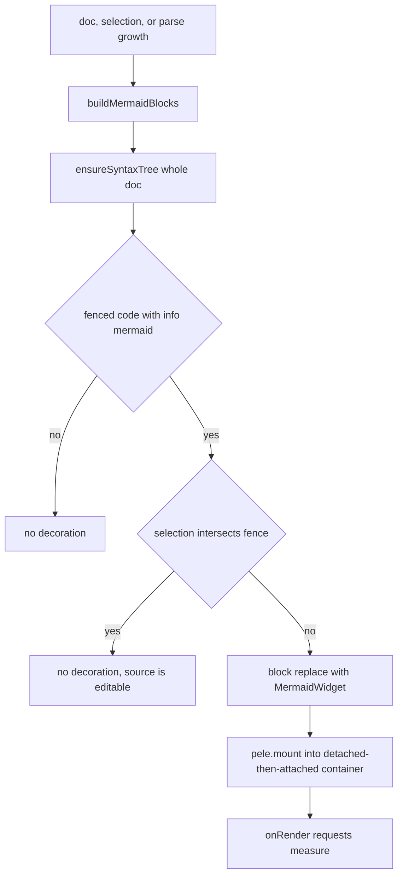

# Mermaid blocks and wider measure

Add mermaid fenced-code rendering to `@atomic-editor/editor` as an opt-in extension, and widen the default text column on desktop. Target repo is this clone only. Do not touch `/Users/sambitsahoo/projects/nnootteess`.

## Decisions already made

- Renderer is `pele` (obsidianmd/pele, MIT, `^1.13.0`). It renders mermaid syntax to SVG with zero dependencies, 230 KB gzip, and CSS-variable theming. Colors change without re-rendering, unlike mermaid's baked theme.
- The extension is exported but not enabled by default. Consumers pass `mermaidBlocks()` through the existing `extensions` prop. The renderer loads through a dynamic `import("pele")` so apps that never render a diagram never download it.
- `pele` goes in `dependencies`, not `peerDependencies`. One install path, no peer ceremony.

## Behavior



- A fence counts when its info string is `mermaid` or starts with `mermaid ` (allow ```` ```mermaid ```` and `~~~mermaid~~~`). Match case-insensitively.
- Skip fences inside tables. The table widget already replaces that source.
- Replace the whole fence, CodeMark lines included, with one block widget. No leftover blank line.
- When any selection range intersects the fence, emit no decoration. The inline preview already reveals the source lines, so the user sees the code they are editing.
- Rebuild on `docChanged`, `selectionSet`, and `treeGrowthEffect`, mirroring `image-blocks.ts`. Parse with `ensureSyntaxTree(state, state.doc.length, 200) ?? syntaxTree(state)`.
- Read-only mode still renders diagrams. The source button hides when `state.facet(readOnlyFacet)` is true.

## Widget

- `eq()` compares the fence code only. same code keeps the same DOM.
- `toDOM(view)` builds `<div class="cm-atomic-mermaid">`, then dynamic-imports `pele` and calls `mount(container, code, { zoom: "auto", onRender: () => view.requestMeasure() })` once the node is attached. Use a `requestAnimationFrame` or an IntersectionObserver-free attach check. The widget must reserve height while the import resolves.
- `destroy(dom)` calls the mounted handle's `destroy()`. Guard against resolving after destroy.
- `ignoreEvent()` returns true for `mousedown`, `click`, `pointerdown`. Diagram zoom and pan must keep working.
- A small "Source" button in the corner reveals the fence by dispatching a selection at `fence.from + 1` and focusing the view. This is the mouse path into edit.
- Import failure renders the raw source plus the error message. Never a blank box.
- `estimatedHeight` around 220 so the scroll heightmap is sane before the SVG lands.

## CSS

Add to `src/styles/inline-preview.css`.

- `.cm-atomic-mermaid`: block spacing with padding, `position: relative`, `min-height`.
- Map Pele variables to the existing atomic tokens so both themes work without JS: `--pele-bg`, `--pele-fg`, `--pele-muted`, `--pele-line`, `--pele-surface`, `--pele-surface-alt`, `--pele-border`, `--pele-accent`, `--pele-error`, `--pele-font`, `--pele-font-mono`.
- Source button styling that only appears on hover or focus-visible.
- Measure change. `.cm-content` currently caps at `var(--atomic-editor-measure, 70ch)`. Make the default 80 percent of the editor width, and full width below 720px:
  - `max-width: var(--atomic-editor-measure, 80%)`
  - `@media (max-width: 720px) { .cm-content { max-width: 100%; } }`
  - Keep `margin-inline: auto`.
- Update `demo/demo.css:465` to the same 80 percent default so the demo matches the library.

## Files

- New `src/mermaid-blocks.ts`.
- `src/index.ts` export `mermaidBlocks` and `MermaidBlocksConfig`.
- `package.json`: add `pele`, bump version to 0.8.0.
- `CHANGELOG.md`: new Unreleased section.
- `README.md`: a "Mermaid diagrams" section with the `extensions` example, and a note on `--atomic-editor-measure`.
- `demo/App.ts` around line 615: pass `mermaidBlocks()` so the demo shows it. Add a mermaid sample to `demo/sample-content.ts` that only appears in the large sample or add a toggle. Keep it simple.
- New `src/__tests__/mermaid-blocks.test.ts`.

## Tests

- A mermaid fence outside the selection produces one block decoration.
- The same fence with a selection inside produces none.
- A fence inside a table produces none.
- A non-mermaid fence produces none.
- An edit elsewhere maps existing decorations without dropping them.
- A closed fence and an open fence both behave without throwing.
- Prefer asserting through a real `EditorState` over mocking CM internals.

## Verification

Run and paste results.

1. `bun run typecheck`
2. `bun test`
3. `bun run build`
4. `bun run dev` then open the demo in a real browser through the browse MCP. Insert a flowchart and a sequence diagram. Screenshot dark and light. Confirm clicking the diagram does not jump to source, the Source button reveals the fence, and the two themes recolor without a reload.
5. At 1440px viewport, measure `.cm-content` and assert it is at least 80 percent of `.cm-scroller` width. At 390px, assert full width.

## Report

Under 40 lines. Files changed, test and build output, screenshot paths, the width numbers, and any deviation from this spec with the reason.
